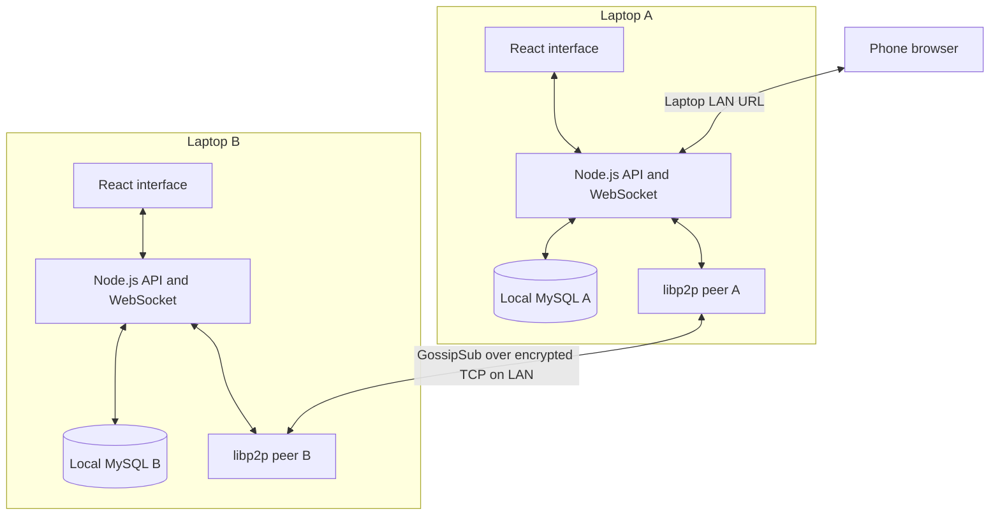
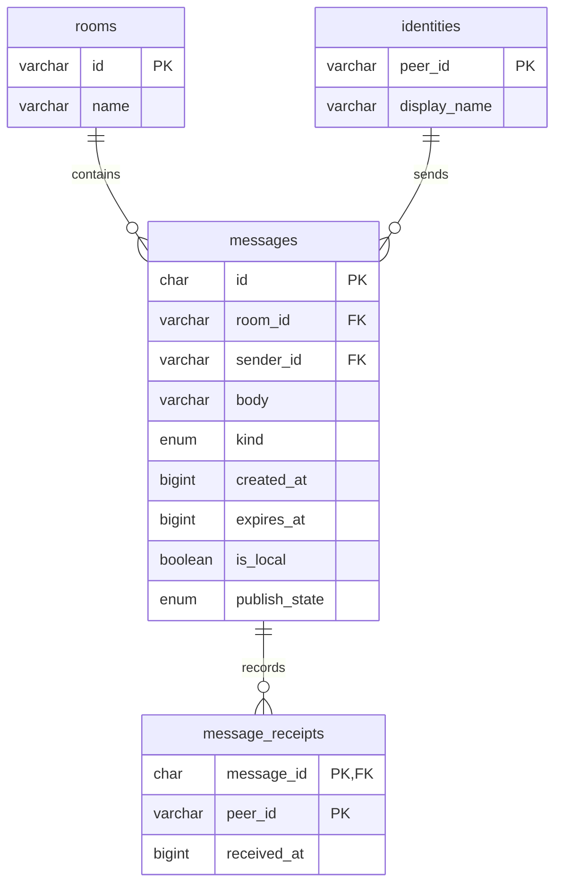

# DisasterNet

Emergency messaging over Wi-Fi, hotspots, or Ethernet LAN without requiring internet access.

## Overview

DisasterNet connects independent Node.js peers over an existing local network. Each peer stores messages in its own MySQL database and serves a React interface. Phones can connect through a laptop's LAN URL.

## Features

- Live General, Rescue coordination, and Food & supplies rooms.
- SOS requests with category, description, and optional location.
- Persistent message history and peer identity.
- mDNS discovery and manual peer connections.
- Signed GossipSub messages, duplicate suppression, pending retries, and storage receipts.
- Bounded reconnect catch-up and live WebSocket updates.
- PIN sessions, responsive interface, and locally bundled assets.

## Technology stack

| Layer | Technology |
|---|---|
| Frontend | React.js, JavaScript, Vite |
| Styling | Tailwind CSS, CSS, Lucide React |
| Backend | Node.js, Express.js |
| Browser updates | WebSocket |
| Peer networking | libp2p, TCP, Noise, Yamux |
| Discovery and broadcasting | mDNS, GossipSub |
| Database | MySQL 8, mysql2 |
| Validation | Zod |

## Architecture



mDNS finds nearby nodes; GossipSub exchanges messages after connection. Each laptop owns its database: MySQL is not centrally shared or automatically replicated. The application distributes messages and stores them independently.

The browser uses HTTP and WebSocket, never direct database access. A phone browser is a client of a laptop, not an independent Node.js peer. Two tabs sharing one service are not two peers.

### Message flow

1. React submits a message to its local Express API.
2. The backend validates it, assigns a UUID, and commits it to MySQL.
3. GossipSub publishes to subscribed peers.
4. The receiver validates the signed sender and commits the message locally.
5. Only after storage succeeds does the receiver send a receipt.
6. WebSocket events update messages and receipt indicators in the interface.

## Requirements

- Node.js **22.14.0 or newer** and npm.
- MySQL **8.0 or newer**, running locally on each independent peer.
- Git and a browser supporting WebSocket.
- A reachable local Wi-Fi, hotspot, or Ethernet network.

Internet is needed initially to install dependencies. Once installed and built, the application can operate without internet while local networking and services remain available. MySQL Workbench alone is not MySQL Server.

## Setup

The examples use Windows PowerShell. Run commands from the repository root.

### 1. Clone and check Node.js

```powershell
git clone https://github.com/Damavarun/DisasterNet.git
cd DisasterNet
node --version
npm --version
```

Install a supported Node version and reopen the terminal if needed. If PowerShell blocks npm scripts, use `npm.cmd` instead of `npm`.

### 2. Start MySQL and create a database

Start your installed MySQL Server using Windows Services or your usual server management tool. Connect using Workbench or:

```powershell
mysql -h 127.0.0.1 -P 3306 -u root -p
```

If the command is unavailable, use the full path to mysql.exe or Workbench. Run the following SQL once as an administrator, choosing your own password:

```sql
CREATE DATABASE disasternet
  CHARACTER SET utf8mb4 COLLATE utf8mb4_bin;

CREATE USER 'disasternet'@'127.0.0.1'
  IDENTIFIED BY 'replace-with-your-local-database-password';

GRANT ALL PRIVILEGES ON disasternet.*
  TO 'disasternet'@'127.0.0.1';
```

If the database/account already exists, reuse it. To change its password:

```sql
ALTER USER 'disasternet'@'127.0.0.1'
  IDENTIFIED BY 'replace-with-your-local-database-password';
```

Use the restricted application account in configuration, not root. Keep MySQL accessible locally; other peers do not connect to your database port.

### 3. Create configuration

```powershell
Copy-Item backend/.env.example backend/.env
```

macOS/Linux equivalent: `cp backend/.env.example backend/.env`. Do not overwrite an existing configured file during routine restarts.

Edit `backend/.env`:

```dotenv
HOST=0.0.0.0
PORT=3001
P2P_PORT=9000
NODE_NAME=Varun
NETWORK_NAME=disasternet-local
DATA_DIR=./data
MYSQL_HOST=127.0.0.1
MYSQL_PORT=3306
MYSQL_USER=disasternet
MYSQL_PASSWORD=replace-with-your-local-database-password
MYSQL_DATABASE=disasternet
BOOTSTRAP_PEERS=
ACCESS_PIN=replace-with-your-private-pin
ALLOWED_ORIGINS=
```

The database password must match step 2. Choose an access PIN of at least eight characters; this is separate from the database password. Use your MySQL server's actual port. Never commit .env or peer identity keys.

### 4. Install and initialize

```powershell
npm ci
npm run db:migrate
npm run build
```

Root npm workspaces install both backend and frontend dependencies. The schema command creates tables and seeds rooms, but does not create the database/user. Startup also initializes the schema idempotently.

### 5. Start the app

```powershell
npm start
```

Open [http://localhost:3001](http://localhost:3001). Enter your display name and configured access PIN. Express serves the built React interface, API, and WebSocket; a separate frontend process is unnecessary in this mode.

Check readiness:

```powershell
Invoke-RestMethod http://localhost:3001/api/health
```

Expected:

```json
{"service":"DisasterNet","ready":true,"database":"mysql"}
```

Keep MySQL and the application running. Press Ctrl+C to stop the app. For later runs, start MySQL if necessary and use `npm start`; do not recreate the database.

### Development mode

```powershell
npm run dev
```

Open Vite's printed URL, usually [http://localhost:5173](http://localhost:5173). Vite proxies /api and /ws to port 3001. Update both targets in `frontend/vite.config.js` if you change the backend port. Rebuild before using npm start to see frontend changes.

## Environment configuration

| Variable | Default / example | Purpose |
|---|---|---|
| HOST | 0.0.0.0 | HTTP bind address; allows LAN clients |
| PORT | 3001 | HTTP and WebSocket port |
| P2P_PORT | 9000 | Peer TCP port |
| NODE_NAME | Local node | Service label; example file uses Varun |
| NETWORK_NAME | disasternet-local | Must match peers; 1–48 letters, digits, or hyphens |
| DATA_DIR | ./data | Identity directory relative to backend/ |
| MYSQL_HOST | 127.0.0.1 | Database hostname |
| MYSQL_PORT | 3306 | Actual database port |
| MYSQL_USER | disasternet | Application database account |
| MYSQL_PASSWORD | Your password | Database credential |
| MYSQL_DATABASE | disasternet | Existing database name |
| BOOTSTRAP_PEERS | Empty | Comma-separated complete peer addresses |
| ACCESS_PIN | Required, at least 8 characters | Local browser login |
| ALLOWED_ORIGINS | Empty | Additional trusted browser origins, comma-separated |

Restart the backend after changes. Display names entered in the UI are separate from NODE_NAME. Network and room names are channel selectors, not passwords.

## Connect multiple devices

### Two laptops

1. Complete setup on both, with separate local MySQL databases and identity directories.
2. Join the same reachable LAN and use the same NETWORK_NAME.
3. Start both apps and allow Node.js through the private-network firewall.
4. Check connected peers. mDNS discovery requires working UDP multicast.
5. If discovery fails, open **Connect node** and paste the other node's full LAN peer address.

Example format:

```text
/ip4/192.168.1.20/tcp/9000/p2p/OTHER_NODE_PEER_ID
```

Copy the actual address reported by that running node, including its peer ID. Do not use 127.0.0.1 between computers. BOOTSTRAP_PEERS can supply addresses for startup dialing. Guest Wi-Fi/client isolation may prevent communication.

### Phone access

Use `ipconfig` on Windows to find the laptop's active LAN IPv4 address. On the phone, open `http://LAPTOP_LAN_IP:3001` and enter that laptop's PIN. Both must be on the reachable LAN; the laptop must stay running.

| Default port | Protocol | Use |
|---|---|---|
| 3001 | TCP / HTTP / WebSocket | Browser access on private LAN |
| 9000 | TCP | Peer connections on private LAN |
| 5353 | UDP multicast | mDNS discovery |
| 3306 | TCP | Local MySQL only |
| 5173 | TCP / HTTP | Vite development UI |

Configured ports replace these defaults. Internet port forwarding is unnecessary.

## Using the app

1. Enter a name and local access PIN.
2. Select General, Rescue coordination, or Food & supplies.
3. Send messages and check status/receipts.
4. Use Send SOS to choose Medical, Trapped, Evacuation, Food & water, or Other; add a description and optional location.
5. Inspect peer status or connect a node manually.
6. Search loaded messages or load older history.

The SOS interface sends to the rescue room. A receipt means storage on another node, not that a person read the message or rescue was dispatched.

## Reliability and synchronization

| State | Meaning |
|---|---|
| Pending | Saved locally, waiting for publication |
| Published | Broadcast with subscribed peers; delivery is not guaranteed |
| Received | Incoming message stored locally |
| Receipt | Identified peer committed the message to MySQL |
| Expired | No longer eligible for retry after its lifetime |

- UUID primary keys suppress duplicate messages.
- Unacknowledged local messages retry every five seconds while unexpired.
- Chat lifetime is seven days; SOS lifetime is 24 hours. Expiry stops distribution, not automatic deletion of saved history.
- Sync requests run every 20 seconds. Each node republishes only its own messages to preserve signed sender authenticity.
- Catch-up is limited to the latest 100 unexpired messages per room and requires the original sender online.
- Browser reconnects use backoff and retrieve history to fill missed updates.
- Preserve `backend/data/peer.key` across restarts. Do not share one identity directory between independent running peers.

## Database design



See `backend/sql/schema.sql` for all columns and indexes. Receipts have a composite primary key of message ID and receiving peer ID. The messages table also acts as the persistent pending queue.

Back up MySQL using normal database tooling and securely preserve the peer identity key. Do not commit dumps or credentials. The schema initializer uses CREATE TABLE IF NOT EXISTS, not versioned ALTER migrations; review future schema changes before updating an existing installation.

## API reference

All paths are relative to the local service. Health and session endpoints are public; other API endpoints and WebSocket require the session cookie from PIN login.

| Method | Endpoint | Purpose |
|---|---|---|
| GET | /api/health | Database readiness, HTTP 200 or 503 |
| GET | /api/session | Authentication status |
| POST | /api/session | Login with a pin field |
| GET | /api/status | Peer identity, addresses, connections, database state |
| GET | /api/rooms | Available rooms |
| GET | /api/messages?roomId=general&limit=100 | Saved room history |
| POST | /api/messages | Submit chat or SOS |
| POST | /api/peers | Dial an address field containing a full multiaddress |
| WS | /ws | Live message and status events |

History accepts optional `before` milliseconds since epoch and limit 1–200. Sender names allow 1–60 characters, message bodies 1–2000, and optional locations up to 160.

Chat body:

```json
{
  "roomId": "general",
  "senderName": "Varun",
  "body": "Water is available at the community hall.",
  "kind": "chat"
}
```

SOS body:

```json
{
  "roomId": "rescue",
  "senderName": "Varun",
  "body": "Two people need medical assistance.",
  "kind": "sos",
  "category": "Medical",
  "location": "Community hall, north entrance"
}
```

Sessions last 12 hours and are in server memory; backend restart requires login again. Login and API rate limits apply. HTTP bodies and WebSocket payloads are limited to 16 KB.

## Commands and testing

| Command | Purpose |
|---|---|
| npm ci | Install locked workspace dependencies |
| npm run dev | Backend watch mode and Vite |
| npm run db:migrate | Initialize schema and rooms |
| npm run build | Build frontend/dist |
| npm start | Serve backend and built frontend |
| npm run lint | Frontend lint |
| npm test | Three unit tests |
| npm run test:integration | MySQL, HTTP, WebSocket, peer and discovery tests |

Integration tests need a separate local test administrator able to create/drop databases:

```powershell
$env:TEST_MYSQL_HOST='127.0.0.1'
$env:TEST_MYSQL_PORT='3306'
$env:TEST_MYSQL_USER='root'
$env:TEST_MYSQL_PASSWORD='your-local-test-password'
npm run test:integration
```

Tests create unique dn_it_* databases and clean those test databases afterward, rather than using the application's database. Defaults are loopback, port 3306, root, and empty password; override for your server.

### Verified results

- Production build, lint, and three unit tests passed.
- All seven checks in the two-local-peer MySQL/HTTP/WebSocket suite passed, including authorization, queued delivery, receipts, SOS/deduplication, sender validation, restart/catch-up, expiry, and API validation.
- The separate mDNS discovery test timed out in the Windows environment. The full integration command therefore does not yet pass completely.
- Physical cross-device acceptance remains outstanding.

### Cross-device acceptance

1. Keep the LAN active while disconnecting internet.
2. Connect two laptop peers and exchange messages across rooms.
3. Verify receipts identify the other node.
4. Stop a node, send from the other, restart/reconnect, and check catch-up.
5. Send without peers, reconnect, and verify retry without duplicates.
6. Open a laptop LAN URL on a phone and check messaging and SOS.

## Troubleshooting

| Problem | Action |
|---|---|
| Unsupported Node/modules | Use Node 22.14+ and npm ci at root |
| PowerShell blocks npm | Use npm.cmd |
| mysql command missing | Use Workbench or full executable path |
| Database connection refused | Start MySQL; check host and actual port |
| MySQL access denied | Match password, account host, and database grants |
| Unknown database | Create it before initialization |
| Invalid PIN configuration | Set ACCESS_PIN to at least eight characters |
| EADDRINUSE | Stop the conflicting process or change HTTP/peer ports |
| Missing or stale frontend | Run npm run build and restart, or use dev mode |
| Dev API unavailable | Match Vite proxy with backend port |
| 401 / incorrect PIN | Use this node's PIN; log in after restart |
| No discovered peers | Match network names, check multicast/firewall/isolation, use manual connection |
| Manual dial fails | Use full current LAN peer address and verify peer TCP port |
| Phone cannot connect | Use laptop LAN IP, check HOST and private-network firewall |
| Pending message | Connect a subscribed peer and wait for retry |
| Published without receipt | Check receiver and its database; publication alone is not delivery |
| Origin rejected | Use LAN IP/localhost or configure exact trusted ALLOWED_ORIGINS |
| Integration database failure | Check TEST_MYSQL_* and create/drop permission |
| mDNS timeout | Check multicast/network adapters; use manual dialing |

## Project structure

| Path | Responsibility |
|---|---|
| package.json / package-lock.json | Workspace commands and locked dependencies |
| backend/.env.example | Configuration template |
| backend/sql/schema.sql | MySQL schema and rooms |
| backend/src/config.js | Environment loading and validation |
| backend/src/index.js | Startup and shutdown |
| backend/src/server.js | API, PIN sessions, WebSocket, static hosting |
| backend/src/service.js | Sending, retries, receipts, synchronization |
| backend/src/network.js | libp2p identity, discovery, peer connections |
| backend/src/store.js | MySQL queries and transactions |
| backend/src/message.js | Message schemas and serialization |
| backend/src/migrate.js | Schema initialization command |
| backend/test/ | Unit and integration tests |
| frontend/src/App.jsx | Dashboard, rooms, peer/profile/SOS dialogs |
| frontend/src/api.js | HTTP client and message merging |
| frontend/src/index.css | Interface styling |
| frontend/vite.config.js | Build and development proxy |

## Limitations

- Requires an existing LAN; does not create Wi-Fi mesh links or bridge disconnected networks.
- Each independent peer needs Node.js and local MySQL.
- Room/network names are not private access controls; subscribed nodes can receive room traffic.
- Noise protects peer links; messages are not end-to-end encrypted against subscribed peers.
- Display names are self-declared. Verified rescue identities, rescue assignment, and trusted announcements are not implemented.
- Browser access uses HTTP by default. Use a trusted LAN; this is not an internet-facing deployment guide.
- Catch-up is bounded and depends on the original sender online; delivery is not guaranteed across partitions.
- SOS submission or storage receipts do not replace emergency-service contact or confirm dispatch.
